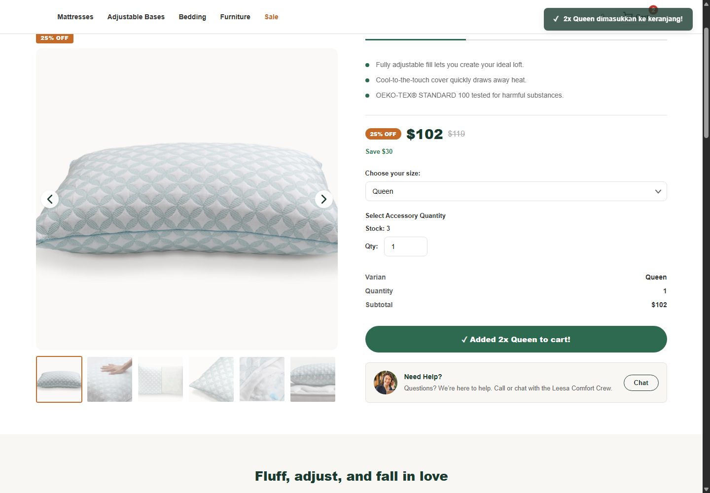

# ASSIGNMENT Day 22 - Mini Project Full-Stack : Case Study Building Interactivity Website with JavaScriptkok

**Nama:** Muhammad Fadli Purnama  
**Batch:** FWD Batch 13  
**Assignment:** Day 22

Mini project halaman detail produk Phase 1 dengan dua implementasi: satu menggunakan data hardcode dan satu mengambil data dari REST API lokal.

> **Repository GitHub:** TODO - tambahkan URL repository setelah proyek di-push.

## Halaman dan fitur

| Halaman | Sumber data | Fitur |
|---|---|---|
| [`page-hardcode/`](page-hardcode/) | Data lokal di `page-hardcode/js/data.js` | Pilih varian, ubah quantity, lihat subtotal dan stok, validasi quantity, toast notification saat Add to Cart, serta badge merah pada tombol Cart yang menampilkan jumlah unit. |
| [`page-api-driven/`](page-api-driven/) | Backend REST API lokal | Memuat produk secara asynchronous, menampilkan loading/error/retry, memilih varian dan quantity, menghitung subtotal dari harga API, memvalidasi stok, serta memberi feedback Add to Cart. |

Nilai harga dan stok mengikuti data yang tersedia pada masing-masing sumber. Tampilan harga saat ini menggunakan mata uang USD.

## Teknologi dan prasyarat

- Node.js `>=20.19` dan npm.
- Docker Desktop dengan Docker Compose, untuk PostgreSQL dan backend.
- Browser modern.
- Visual Studio Code Live Server (untuk menjalankan halaman hardcode).

## Endpoint API

Halaman API menggunakan `GET /api/products/1` untuk mengambil detail produk. Saat development, Vite meneruskan request relatif `/api` ke backend di `http://localhost:3000`, sehingga frontend tidak perlu memanggil host backend langsung dari browser.

Endpoint backend yang tersedia antara lain:

| Method | Path | Keterangan |
|---|---|---|
| `GET` | `/health` | Health check |
| `GET` | `/api/products` | Daftar produk |
| `GET` | `/api/products/:id` | Detail produk |
| `GET` | `/api-docs` | Dokumentasi Swagger |

## Cara menjalankan

### 1. Jalankan backend dan database

Buka terminal dari direktori repository:

```powershell
cd .\backend
Copy-Item .env.example 
```

Buat file .env dan pindahkan kode .env.example kedalam file .env. Edit file `backend/.env`. Jika mengganti `POSTGRES_PASSWORD`, sesuaikan juga password pada `DATABASE_URL`. Jangan commit file `.env` atau credential.

```powershell
docker compose up -d postgres
npm install
npm run prisma:generate
npm run prisma:migrate
npm run prisma:seed
npm run dev
```

Backend berjalan di `http://localhost:3000`. Dokumentasi backend lebih lanjut tersedia di [`backend/README.md`](backend/README.md).

### 2. Jalankan halaman API-driven

Buka terminal baru dari direktori repository:

```powershell
cd .\page-api-driven
npm install
npm run dev
```

Buka URL yang ditampilkan Vite (default: `http://localhost:5173`). Pastikan backend dan PostgreSQL tetap berjalan.

### 3. Jalankan halaman hardcode

Buka folder `page-hardcode` di VS Code, lalu jalankan `index.html` menggunakan ekstensi Live Server. **Jangan membuka file langsung melalui `file://`, karena browser dapat membatasi pemuatan JavaScript module.**

## Cara menguji

Uji manual kedua halaman melalui browser. Screenshot skenario tersimpan di [`evidence/screenshots/`](evidence/screenshots/); tinjauan kriteria dan catatan hasil yang lebih lengkap ada di [`requirement.md`](requirement.md).

| No. | Input/kondisi | Expected result | Actual result | Bukti |
|---:|---|---|---|---|
| 1 | Hardcode: Queen, quantity `2` **(sudah ada pada phase 1)** | Subtotal `$102 × 2 = $204`. | Subtotal `$204`. | [Screenshot](evidence/screenshots/01-hardcode-queen-qty-2.png) |
| 2 | Hardcode: ubah quantity `2` menjadi `3` **(sudah ada pada phase 1)** | Subtotal berubah tanpa reload menjadi `$306`. | Subtotal berubah menjadi `$306` tanpa reload. | [Screenshot](evidence/screenshots/02-hardcode-queen-qty-3-no-reload.png) |
| 3 | Hardcode: quantity `0`, `1.5`, `-1`, dan `6` saat stok `5` **(sudah ada pada phase 1)** | Input tidak valid ditolak dan feedback ditampilkan. | Semua nilai menampilkan feedback; quantity `6` ditolak karena stok `5`. | [0](evidence/screenshots/03a-hardcode-invalid-zero.png), [1.5](evidence/screenshots/03b-hardcode-invalid-fraction.png), [-1](evidence/screenshots/03c-hardcode-invalid-negative.png), [6](evidence/screenshots/03d-hardcode-invalid-over-stock.png) |
| 4 | Hardcode: tekan Add to Cart dengan quantity `2` **(penambahan interaksi dari phase 1 untuk assignment ini)** | Toast notification tampil, badge merah pada tombol Cart bertambah menjadi `2`, dan stok `5` menjadi `3`. | Toast sukses muncul, badge merah Cart menampilkan `2`, dan stok tersisa `3`. | [Screenshot](evidence/screenshots/04-hardcode-add-to-cart-toast-cart-stock.png) |
| 5 | API: request ditahan saat halaman dimuat **(sudah ada pada phase 1)** | Loading tampil selama request belum selesai. | Indikator loading terlihat saat request ditahan. | [Screenshot](evidence/screenshots/05-api-loading.png) |
| 6 | API: produk termuat, quantity `2` **(sudah ada pada phase 1)** | Subtotal dihitung dari harga pada response API × quantity. | Harga response `$89`; subtotal quantity `2` adalah `$178`. | [Screenshot](evidence/screenshots/06-api-success-subtotal-qty-2.png) |
| 7 | API: quantity `0`, `1.5`, `-1`, dan `9` saat stok `8` **(sudah ada pada phase 1)** | Input tidak valid ditolak dan feedback ditampilkan. | Semua nilai menampilkan feedback; quantity `9` ditolak karena stok `8`. | [0](evidence/screenshots/07a-api-invalid-zero.png), [1.5](evidence/screenshots/07b-api-invalid-fraction.png), [-1](evidence/screenshots/07c-api-invalid-negative.png), [9](evidence/screenshots/07d-api-invalid-over-stock.png) |
| 8 | API: Add to Cart quantity `2` **(penambahan interaksi dari phase 1 untuk assignment ini)** | Feedback tampil dan stok lokal `8` menjadi `6`. | Feedback tombol tampil; stok tersisa `6`. | [Screenshot](evidence/screenshots/08-api-add-to-cart-stock-decrement.png) |
| 9 | API: request gagal lalu retry **(sudah ada pada phase 1)** | Error tampil tanpa loading; retry memuat produk kembali. | Error tampil dan loading tersembunyi; retry berhasil. | [Request gagal](evidence/screenshots/09-api-request-error-no-loading.png), [Retry berhasil](evidence/screenshots/10-api-retry-success.png) |

Pengujian tersebut dijalankan manual di browser; belum tersedia test runner otomatis untuk kedua halaman. Skenario request gagal disimulasikan di browser dan tidak mengubah data database.

### Bukti Add to Cart halaman hardcode

Pembaruan dari Phase 1 untuk assignment ini mencakup toast notification setelah tombol Add to Cart ditekan dan badge merah pada tombol Cart yang menunjukkan jumlah unit.



## Penggunaan AI

AI digunakan untuk membantu meninjau kesesuaian proyek dengan panduan, memperbaiki validasi quantity dan stok, menganalisis alur API, dan menyusun dokumentasi. Penulis tetap bertanggungjawab memahami perubahan serta memverifikasi hasil sebelum mengumpulkan assignment.
